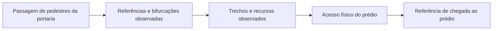

# Levantamento do piloto — Portarias 1 e 2 e prédios A, B, C, D e L

**Recorte confirmado pelo usuário em 08/11/2026. Status: inventário documental com relato inicial de três alternativas P1 → A; levantamento presencial e georreferenciamento pendentes.**

Este pacote inicia as etapas 0 e 4 do [plano de navegação](../../implementation_plan.md). Define os destinos, os percursos a investigar e as fichas para registrar cada acesso, trecho e recurso de acessibilidade. Não é uma malha de navegação publicada: não há trajetos, medidas ou acessos físicos validados nestes arquivos.

**Primeiro marco confirmado pelo usuário: somente chegar ao prédio.** O percurso termina em um ponto de acesso físico identificado, sem exigir navegação até salas ou circulação interna. Não assumir que a chegada seja no térreo. Desníveis e recursos no caminho até esse ponto continuam relevantes para as restrições de mobilidade.

## 1. Pontos incluídos

Os códigos e nomes foram conferidos na seção de mapa do [site oficial da UniFacens](https://facens.br/). O [guia institucional de chegada](https://blog.facens.br/facens-me-ajuda-onde-comer-e-como-se-locomover-para-a-faculdade/), publicado em 16/01/2025, também descreve duas portarias e identifica a P2 no Iguatemi. Consulta em 08/11/2026; a consulta documental não comprova condições de passagem na data de uso.

| ID de levantamento | Ponto | O que levantar primeiro |
| --- | --- | --- |
| `PORT-P1` | Portaria 1 — Castelinho | Passagem de pedestres, controle de entrada, eventual alternativa à catraca e ligação à circulação interna |
| `PORT-P2` | Portaria 2 — Iguatemi | Passagem de pedestres, controle de entrada, eventual alternativa à catraca e ligação à circulação interna |
| `PRED-A` | Prédio A | Acessos encontrados e referências de chegada ao prédio |
| `PRED-B` | Prédio B | Acessos encontrados e referências de chegada ao prédio |
| `PRED-C` | Prédio C | Acessos encontrados e referências de chegada ao prédio |
| `PRED-D` | Prédio D | Acessos encontrados e referências de chegada ao prédio |
| `PRED-L` | Prédio L | Acessos encontrados e referências de chegada ao prédio |

A lista é um recorte de trabalho, não uma classificação de quais prédios são mais importantes para toda a comunidade. Outros locais podem ser adicionados quando confirmados pela equipe. O marco atual cobre a circulação das portarias aos acessos dos prédios; destinos internos e mudanças de andar dentro deles serão tratados em uma expansão posterior.

O [mapa ilustrado oficial](https://facens.br/wp-content/uploads/2025/05/mapaindexnorender.jpg) ajuda a reconhecer o conjunto, mas não fornece escala georreferenciada ou medidas de rampas. Não extrair lat/lon, distâncias de caminhada ou continuidade de acessibilidade a partir dos pixels da ilustração.

## 2. Situação dos recursos e obras de acessibilidade

O [PDI 2018–2022, com capa de 2021](https://pergamum.facens.br/pergamumweb/download/CA4FCEBE-2759-401C-BEE5-B447BF20DACE.pdf#page=186), páginas impressas 183–184, relata adaptações em acessos, elevadores e corredores e trata de sinalização tátil/Braille. É uma referência histórica institucional, sem localização e condição operacional atual de cada recurso dos prédios deste piloto.

Assim, **nenhuma rampa, elevador ou passagem específica de A/B/C/D/L foi marcada como existente e compatível neste inventário**. A existência, posição e condição de cada item serão registradas no campo, ou em planta/registro técnico com origem identificada e posterior conferência. A [página institucional de estacionamento](https://facens.br/a-facens/estacionamento/) menciona espaços reservados para pessoas com deficiência; os locais exatos e suas conexões com os caminhos do piloto ainda precisam ser levantados.

| Item a investigar | Como representar no caminho | Informação necessária |
| --- | --- | --- |
| Passagem de pedestres/portão alternativo | Nó de acesso e trechos de aproximação/saída | Largura livre, soleira, controle, horário, ajuda necessária e conexão real |
| Rampa/rebaixamento de guia | Trecho com início/fim; nó em cada mudança relevante | Comprimento, inclinações, largura, desnível, piso, patamares e apoio |
| Escada/degrau | Trecho de barreira para necessidades incompatíveis | Degraus, largura, apoio, piso e alternativa realmente conectada |
| Elevador/plataforma | Nó de acesso por pavimento e ligações verticais | Tipo real, dimensões de acesso/cabine, andares, funcionamento e assistência |
| Corrimão/apoio | Recurso associado a trecho | Lados, continuidade, condição e limites do segmento atendido |
| Piso tátil/placa tátil | Segmentos e referências associados aos nós/trechos | Direcional/alerta, início/fim, continuidade, interrupções e obstáculos |
| Vaga reservada/desembarque | Nó de origem e conexão até circulação de pedestres | Localização, saída, rebaixamento e possíveis travessias |
| Banco/descanso/área protegida | Nó/recurso conectado ao caminho | Acesso ao ponto, condição de uso e distância ao próximo apoio |
| Obra, tapume ou interdição | Ocorrência vinculada ao trecho afetado | Bloqueio parcial/total, largura restante, período e desvio conferido |

Separar **recurso existente**, **barreira observada**, **interdição temporária** e **necessidade de intervenção**. Uma sugestão de construir rampa não significa que a rampa existe, foi aprovada ou pode ser usada no cálculo.

## 3. Percursos a levantar

| Portaria | Destinos | Verificação |
| --- | --- | --- |
| P1 | A, B, C, D e L | Ida e volta independentes |
| P2 | A, B, C, D e L | Ida e volta independentes |

São **10 pares de locais e 20 tarefas direcionais**, preparados em [percursos.csv](percursos.csv). São objetivos de levantamento; não afirmam ligação direta, número de acessos, distância ou existência de percurso compatível.

**Primeiro relato recebido — P1 → A:** o usuário informou três caminhos. Um passa por calçada em subida e passarela; os outros dois foram descritos em conjunto, interpretados inicialmente como escadinha → calçada → rampa → passarela. No complemento, esclareceu que 02 e 03 se separam numa bifurcação relacionada ao andar inferior aberto do prédio A, sem salas de aula. A posição dessa bifurcação na sequência, os lados de cada ramal e eventual reencontro permanecem pendentes. O [registro P1 → A](relatos/p1-a.md) preserva os relatos e as informações ainda necessárias. Não há confirmação de ausência de degraus no primeiro, de compatibilidade com mobilidade reduzida, de identidade dos trechos compartilhados ou do caminho de volta. O andar inferior é referência de circulação; chegar nele não equivale a alcançar uma sala de aula.

Os caminhos compartilham trechos. Registrar cada trecho físico uma vez por sentido e reutilizar seu ID em todos os percursos que o utilizam. Não duplicar a rampa ou cruzamento só porque aparece em cinco viagens diferentes. Caminhos entre prédios poderão ser derivados quando a rede levantada os conectar; a continuidade também deverá ser conferida.

Para múltiplas entradas, adicionar alternativas do percurso com IDs próprios e registrar o acesso final efetivamente alcançado. Concluir uma ida não confirma a volta: inclinação, controle e disponibilidade podem diferir. Se a ligação não existir, registrar a constatação e sua evidência em vez de desenhar uma linha reta.

## 4. Como decompor cada caminho

Diagrama conceitual de coleta, sem representar a disposição real do campus:

Criar um nó onde a pessoa precisa decidir, mudar de nível ou passar por um acesso: bifurcação, travessia, início/fim de rampa, patamar relevante, porta, ponto de descanso e entrada de elevador/plataforma. A geometria entre nós registra o caminho realmente percorrido.

Exemplo de convenção, **sem constituir registros reais**: `NO-P1-001`, `NO-C-001`, `TR-0001-IDA`, `TR-0001-VOLTA`, `REC-0001`. Os IDs devem continuar estáveis depois que a posição for corrigida.

- O ID `PRED-C` identifica o destino agregado; não é a porta nem o centro físico a usar como chegada.
- Cada entrada confirmada recebe seu próprio `node_id`, com `local_id = PRED-C`.
- Uma portaria pode exigir nós separados antes/depois do controle e passagem alternativa. Não colocar o ponto sobre a cancela de veículos por conveniência.
- Um cruzamento entre prédios pode ter `local_id` vazio e referência física clara; não inventar prédio de pertencimento.
- Altitude não determina andar. Para interior, registrar andar e referência/planta; coordenadas locais só fazem sentido com a planta de origem e não são lat/lon.

## 5. Arquivos para preenchimento

| Arquivo | Conteúdo |
| --- | --- |
| [inventario.json](inventario.json) | Sete locais confirmados documentalmente, fontes e situação do levantamento |
| [relatos/p1-a.md](relatos/p1-a.md) | Primeiro relato do usuário: três alternativas P1 → A, com ambiguidades e medidas pendentes |
| [percursos.csv](percursos.csv) | Vinte tarefas de ida/volta, com campos para nós e sequência dos trechos |
| [nos.csv](nos.csv) | Entradas, referências e pontos de decisão efetivamente observados |
| [trechos.csv](trechos.csv) | Conexões direcionais, geometria, medidas e condições de passagem |
| [recursos.csv](recursos.csv) | Facilitadores, barreiras, interdições e necessidades de intervenção observados |

As três fichas físicas têm somente cabeçalho: nenhum acesso foi inventado para preencher a planilha. Os arquivos usam UTF-8, separador vírgula e números decimais com ponto. Texto com vírgula deve ser colocado entre aspas; múltiplos IDs em uma célula usam `|` e mantêm a ordem. Datas/hora usam ISO 8601 com fuso, por exemplo `2026-11-08T14:30:00-03:00` (exemplo de formato, não observação).

Campos vazios significam **não levantado**, nunca zero, ausência, permissão ou aprovação. Quando houver inspeção sem recurso, registrar `nao_encontrado_na_inspecao` com área inspecionada e evidência; isso não prova ausência no prédio inteiro.

### Identificadores e campos

- `local_id`: um dos sete `surveyId` do inventário, quando aplicável.
- `node_id`: ponto físico único; `node_origem_id` e `node_destino_id` referenciam linhas de `nos.csv`.
- `tipo` em nós: `passagem_portaria`, `acesso_predio`, `bifurcacao`, `travessia`, `inicio_rampa`, `fim_rampa`, `patamar`, `acesso_elevador`, `acesso_plataforma`, `descanso` ou descrição específica justificada.
- `andar`: identificação da placa/planta; não preencher a partir de altitude. Se houver convenção diferente entre prédios, registrá-la nas observações.
- `latitude/longitude`: WGS84 observado com método, data e precisão. Não usar a coordenada do centro do campus para todos os pontos.
- `planta_id`, `x_local_m`, `y_local_m`: alternativa local medida em planta identificada. Registrar seu referencial em arquivo associado; não sobrepor ao campo geográfico.
- `estado_existencia`: `observado`, `relatado`, `nao_encontrado_na_inspecao` ou `desconhecido`. Relato não equivale a observação.
- `estado_operacional`: `disponivel`, `indisponivel`, `restrito` ou `desconhecido`, com data. Disponível não equivale a compatível com qualquer usuário.
- `classe` em recursos: `facilitador`, `barreira`, `interdicao` ou `necessidade_intervencao`.
- `metodo`: instrumento, procedimento e limites da medição; responsável identifica quem levantou, não precisa conter documento pessoal.
- `geometria_arquivo`: referência a pontos ordenados do trecho, com sistema/unidade e pavimento identificados. WGS84 usa `[longitude, latitude]`; não misturar com a convenção antiga `[latitude, longitude]` da fixture. Separar direção invertida ou registrar referência reversa explícita.
- `medidas_arquivo`: ficha associada quando a tabela não comportar detalhes de cabine, portas, rampas por lance, patamares, condições e critérios. Ausência da ficha mantém essas medidas desconhecidas.
- `evidencias`: referências relativas a fotos/fichas autorizadas. Evitar pessoas identificáveis e dados pessoais nas capturas.

Para trechos bidirecionais, registrar e conferir as duas direções. Inclinação longitudinal pode ser assinada: positiva na subida no sentido origem → destino; explicar a convenção no arquivo de medição. Inclinação transversal deve registrar magnitude e lado quando relevante. Em equipamentos verticais, dimensões, espera e andares não devem ser convertidos artificialmente em uma rampa de comprimento zero.

As fichas não são formato de importação aceito pela API atual. Uma importação futura terá validação, resolução de IDs, revisão e publicação próprias. `routingEnabled: false` é apenas uma marca documental; estes arquivos não são consumidos pelo aplicativo ou pelo banco.

## 6. Roteiro da primeira vistoria

1. Registrar cada portaria: nome da placa, passagem de pedestres, limite externo/interno, horário e controle observado. Identificar referência de origem reproduzível.
2. Visitar A/B/C/D/L e enumerar os acessos encontrados com fotos/referências; confirmar em qual andar cada um desemboca e quais ficam restritos.
3. Percorrer as ligações das duas portarias aos acessos encontrados, marcando bifurcações, travessias, rampas, escadas, patamares e barreiras. A ordem de visita depende do caminho real, não da ordem das letras.
4. Medir os trechos e recursos relevantes nos dois sentidos. Confrontar medições com os critérios aplicáveis com apoio da equipe competente, sem preencher limites normativos por memória.
5. Compor cada percurso com IDs de trechos consecutivos, entrada correta e referência de chegada. Verificar continuidade em campo, inclusive da sinalização tátil quando houver.
6. Revisar com outro integrante; registrar o que ficou sem medida, sem cobertura ou interditado. Só então preparar dados para o motor de rotas.

A primeira rodada termina em um acesso identificado do prédio. A identificação do ponto de chegada e sua ligação ao caminho precisam ser conferidas; estar perto da fachada ou do centro do prédio não basta. Para afirmar chegada a uma sala, será necessário mapear também circulação interna, pavimentos e acesso da sala correspondente em uma expansão posterior.

## 7. Referências antigas que não serão promovidas automaticamente

- A [fixture atual](../../unifacens-api/src/modules/routing/campus-fixture.ts) descreve seus footprints como retângulos aproximados e calcula entradas por deslocamento de coordenadas. Ela não mede as portas reais; também não inclui D, L e as duas portarias no inventário de obstáculos/acessos.
- Os [marcos antigos](../../unifacens-client/src/constants/campus-landmarks.ts) e os seeds AR são exemplos/referências do software. Há uma divergência: a mesma coordenada é usada como centro de C na fixture e como referência da biblioteca nos marcos. Isso exige revisão, não a escolha automática de um dos valores.
- O [limite geográfico atual](../../packages/shared/src/constants/campus.ts) espelha a fixture. Deve ser reavaliado a partir do levantamento, inclusive para saber se as duas portarias e o L estão cobertos; não ajustar limites para encaixar dados não conferidos.

O inventário novo deixa posições e quantidade de acessos como `null` justamente para evitar que esses exemplos sejam confundidos com pontos levantados presencialmente.

## 8. Critério de conclusão deste mapeamento

- [x] Recorte definido: P1/P2 e A/B/C/D/L.
- [x] Nomes e códigos conferidos em fonte institucional.
- [x] Tarefas direcionais e fichas de campo preparadas.
- [ ] Posições, referências e acessos físicos registrados em campo.
- [ ] Recursos, barreiras e condições documentados por trecho.
- [ ] Medidas e evidências revisadas; lacunas explícitas.
- [ ] Percursos conectados e percorridos nos sentidos declarados.
- [ ] Conjunto validado pelos critérios do motor e publicado com versão identificada.

No momento, o resultado é **inventário documental, relato inicial de P1 → A e preparação de coleta**. Acessibilidade dos percursos, disponibilidade dos equipamentos e distância real permanecem pendentes.
