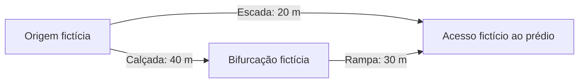

# Navegação acessível — núcleo de cálculo em desenvolvimento

Primeiro incremento implementado em 08/11/2026 na branch `feat/navegacao-acessivel`: contratos, avaliação de elegibilidade e busca de menor distância em uma rede de trechos dirigidos. O marco de produto permanece a chegada a um acesso identificado do prédio.

O segundo incremento conecta o núcleo ao PostgreSQL e à API em `/navigation/networks`. A tela de planejamento ainda será implementada. O endpoint legado `/routing/route` mantém sua implementação anterior; não recebeu estas regras. Os relatos e fichas de campo não foram importados automaticamente, e a rede fictícia dos testes não é inserida em ambientes reais.

## 1. O que já pode ser desenvolvido sem o levantamento

O cálculo recebe nós, conexões e comprimento de cada trecho. Coordenadas são opcionais para esta etapa; permitem-se posição geográfica, posição local com referencial identificado ou `null`. A distância calculada é a soma dos comprimentos recebidos, não uma estimativa pelo centro dos prédios.

A fixture de teste é inteiramente fictícia, inclusive nomes, medidas, evidências e datas. Não representa os três caminhos reais P1 → A nem comprova conformidade de rampa, piso ou largura.



- Sem restrição a degraus, o menor caminho do exemplo tem 20 m.
- Com `stepFree: true`, a escada é excluída e o caminho restante tem 70 m.
- Se esse segundo caminho estiver fechado, o resultado será `no_route`; não há relaxamento automático da restrição.
- Se a largura exigida ou a verificação do segundo caminho estiver ausente/vencida, o resultado poderá ser `insufficient_data`; o caminho incerto não é devolvido como recomendação.

## 2. Contratos compartilhados

Schemas e tipos inferidos estão em [`navigation.schema.ts`](../packages/shared/src/schemas/navigation.schema.ts), reexportados por `shared`. Não foi adicionada dependência nova de validação.

| Contrato | Conteúdo |
| --- | --- |
| `NavigationNode` | ID, nome, tipo e posição opcional; o nó do tipo `building_access` representa o acesso de chegada |
| `NavigationEdge` | Direção, tipo, comprimento, medidas, condições do piso, apoios, verificação e disponibilidade |
| `NavigationGraph` | Nós/trechos, versão e origem `demo` ou `field_survey`; valida IDs únicos e referências dos trechos |
| `NavigationNeeds` | Critérios funcionais escolhidos para o cálculo; sem diagnóstico ou limiar normativo implícito |
| `NavigationRequestInput` | Entrada com origem/destino por nó, modo e critérios opcionais |
| `NavigationAssessment` | Elegibilidade e códigos de motivos de exclusão |
| `NavigationResult` | Resultado discriminado com versão da rede, origem dos dados e critérios aplicados |

Campos desconhecidos de medida/apoio são `null`; verificação ausente assume `unverified` e disponibilidade ausente assume `unknown`. O contrato recusa propriedades não reconhecidas; não aceita opções ainda não implementadas, como uma preferência de menor esforço, para depois ignorá-las.

### Critérios implementados

| Campo | Efeito |
| --- | --- |
| `stepFree` | Exclui escadas e qualquer trecho com degraus; exige contagem conhecida igual a zero nos demais |
| `avoidLifts` | Exclui elevadores e plataformas |
| `minWidthMeters` | Exige largura conhecida maior ou igual à solicitada |
| `maxUphillSlopePercent` | Limita a subida no sentido do trecho |
| `maxDownhillSlopePercent` | Limita a descida no sentido do trecho |
| `maxCrossSlopePercent` | Limita a inclinação transversal |
| `requireHandrail` | Exige apoio declarado como presente no trecho |
| `requireTactilePaving` | Exige sinalização tátil declarada no trecho |
| `requireFirmSurface` | Exige piso declarado como firme e regular |

Os números são escolhas de entrada que ainda precisam de definição de produto e conferência de campo, não valores legais predefinidos. Campos não selecionados não impõem limites numéricos. Um resultado `ok` significa compatibilidade com os critérios informados sobre os dados recebidos, não acessibilidade universal nem certificação física.

`longitudinalSlopePercent` é assinada: positiva na subida e negativa na descida, sempre em relação a `fromNodeId → toNodeId`. Na direção oposta, criar/conferir outro trecho; o motor não inventa o retorno.

A presença de sinalização tátil ou corrimão é uma informação do trecho completo, não a simples existência de um ponto isolado no prédio. O modelo atual não representa as dimensões detalhadas de cabine, continuidade tátil entre conexões, tipo/lado do corrimão ou todas as condições necessárias a cada pessoa. Não apresentar suporte a requisitos ainda não modelados. Essas extensões exigirão contratos, política e testes próprios.

### Verificação e disponibilidade

Trechos elegíveis precisam ter verificação com evidência, `verifiedAt` e `validUntil`, além de disponibilidade `open` com `checkedAt` e `validUntil`. Os intervalos incluem o início e excluem o fim. Datas no futuro, vencidas, informação desconhecida e interdição impedem recomendar o trecho.

`closed` permanece impeditivo até uma atualização explícita. O núcleo não converte interdição antiga em passagem livre. O relógio é injetado no cálculo para permitir testes reproduzíveis; na integração HTTP, o servidor define esse instante.

Esses campos são metadados recebidos, não um mecanismo de comprovação de evidência. Na API, a rede e suas verificações vêm da persistência administrada no servidor. O pedido de cálculo não aceita grafo, data de avaliação ou declaração de aprovação enviados pelo usuário. Na importação de `field_survey`, toda aprovação recebida é descartada e substituída por `unverified`; publicar exige uma revisão administrativa explícita, com evidências, validade futura e posições para todos os nós. A data da revisão é definida pelo servidor. A autenticidade e a adequação física das evidências dependem da conferência do responsável; não são inferidas pelo sistema.

## 3. Como funciona a busca

1. Validar rede, pedido e instante da avaliação.
2. Impedir rede `demo` no modo `navigation`, que é o padrão. Testes usam explicitamente `demonstration`.
3. Verificar se origem/destino existem.
4. Avaliar cada trecho com `assessNavigationEdge`; os motivos têm textos em `NAVIGATION_REASON_LABELS`.
5. Executar Dijkstra sobre os trechos elegíveis, somando comprimento positivo e preservando direção e sequência de IDs.
6. Se não houver caminho, verificar se uma conexão seria possível apenas após preencher/atualizar informações. Essa busca serve somente para distinguir falta de dados de ausência de rota; nunca publica o trajeto incerto.

Não há suavização, atalho por proximidade ou fallback em linha reta. Ciclos são tratados e o grafo recebido não é alterado. Os comprimentos são somados sem arredondamento por trecho; a interface poderá formatar o valor final.

| Status | Significado |
| --- | --- |
| `ok` | Caminho encontrado; retorna nós, trechos e distância |
| `no_route` | Não existe caminho dirigido permitido sob as condições conhecidas |
| `insufficient_data` | Um caminho dependeria de informações ausentes/vencidas; não retorna trajeto |
| `node_not_found` | Origem ou destino não existe na rede recebida |
| `demo_not_allowed` | Rede fictícia foi solicitada para navegação real |

Dados inválidos geram erro de validação, em vez de distância ou rota fabricada. Falhas incluem os trechos excluídos e seus motivos; essa lista cobre a rede avaliada e pode conter trechos fora da região de interesse do usuário. A futura API/interface deve selecionar explicações pertinentes. Cobertura geográfica, resolução de coordenadas e `placeId` ainda serão responsabilidades da integração.

## 4. Verificação e reprodução

Os testes unitários estão em [`test/unit/navigation`](../unifacens-api/test/unit/navigation/navigation.spec.ts), junto às demais verificações de contratos compartilhados do repositório. São testes de funções puras, sem mocks de banco nem dependência de serviços externos. A [integração da navegação](../unifacens-api/test/integration/navigation/navigation.integration.spec.ts) usa PostgreSQL 16 descartável, migrations oficiais, login Better Auth e JWT/JWKS reais. Não há mocks de serviços, repositories ou guard.

Na raiz:

```powershell
npm run build --workspace=shared
npm exec --workspace=unifacens-api -- vitest run test/unit/navigation/navigation.spec.ts
npm exec --workspace=unifacens-api -- vitest run test/integration/navigation/navigation.integration.spec.ts
```

Também executar build da API, lint, typecheck e a suíte completa antes dos marcos de integração. Não foi adicionada tela ou alteração nativa neste incremento; testes de câmera e percurso físico pertencem às etapas posteriores.

No primeiro incremento, a suíte passou com 100 testes em 12 arquivos, incluindo 31 testes novos do núcleo. O segundo acrescentou **18 testes de integração**, totalizando **118 testes aprovados em 13 arquivos**. Foram verificados importação/publicação, cálculo com JWT comum, rollback em falha real de gravação, concorrência, retirada de versão antiga, reaplicação da migration e documentação OpenAPI. Build de `shared` e da API, lint, tipos do monorepo/API/testes e exportação web passaram. A checagem do Drizzle confirmou que o schema não possui mudanças adicionais a migrar. O banco usado para a integração foi descartável; a migration ainda deve ser aplicada nos ambientes de execução conforme seu procedimento de atualização.

## 5. Persistência e API

As novas tabelas são `navigation_networks`, `navigation_versions`, `navigation_nodes` e `navigation_edges`. As chaves dos nós/trechos incluem rede e versão; FKs impedem ligações para outro conjunto. As medidas e verificações de cada trecho, referências de evidência, autor da importação/publicação e datas são persistidos. Não há armazenamento de arquivos comprobatórios neste incremento: os IDs de evidência são referências para o processo de revisão.

Importar rede, versão, nós e trechos é uma única transação com inserções em lote. A leitura do conteúdo usa um snapshot consistente e consultas em lote. A API limita cada versão a 1000 nós e 1000 trechos; o limite JSON do servidor continua em 1 MB. A migration é aditiva, gerada pelo Drizzle e ajustada para reaplicação idempotente; os testes não alteram o banco de desenvolvimento ou de produção.

| Operação | Endpoint | Acesso |
| --- | --- | --- |
| Listar versões | `GET /navigation/networks?limit=50&offset=0` | Autenticado; usuários comuns veem somente versões publicadas ativas |
| Importar grafo | `POST /navigation/networks` | Admin; corpo `NavigationGraph`, sempre cria rascunho |
| Consultar versão | `GET /navigation/networks/:networkId/versions/:version` | Autenticado; rascunho/histórico retirado somente para admin |
| Publicar revisão | `POST /navigation/networks/:networkId/versions/:version/publish` | Admin |
| Calcular percurso | `POST /navigation/networks/:networkId/versions/:version/route` | Qualquer usuário autenticado |

O cálculo tem uma exceção explícita de consulta autenticada no guard. Importação, publicação e as demais mutations continuam exigindo admin. `@AdminOnly()` prevalece se combinado com essa exceção; nenhum endpoint de cálculo é público.

### Importação e publicação

1. Um admin importa o grafo pelo endpoint de cadastro. `id` e `version` aceitam letras, números, ponto, hífen e sublinhado. Não há alteração de versão existente: conflito retorna 409 e exige novo identificador de versão.
2. A resposta é um rascunho. O admin pode consultá-lo; usuário comum recebe 404 para evitar consumir dados ainda não publicados. A origem `demo`/`field_survey` é fixa para o ID da rede; mudar de origem exige outra rede.
3. Para publicar uma demonstração, enviar `{}`. Ela permanece marcada como `demo` e só calcula com modo explícito `demonstration`; o modo padrão é `navigation`, que retorna `demo_not_allowed`.
4. Para publicar levantamento, conferir os dados e enviar `review` com `evidenceIds` e `validUntil` ISO 8601 futuro. Todos os nós precisam de posição geográfica ou local com referencial identificado. O servidor registra a nova revisão e o responsável; campos físicos desconhecidos continuam desconhecidos e as restrições continuam sendo aplicadas pelo motor.
5. A publicação é transacional e idempotente. Existe no máximo uma versão ativa publicada por rede. Publicar uma nova retira a anterior (`retired`), preservando seus dados e datas para consulta administrativa; ela não aceita novos cálculos nem reativação. Uma mudança de disponibilidade/interdição precisa ser publicada em uma nova versão.

Isso permite substituir uma versão com passagem livre por outra com um trecho interditado sem continuar oferecendo cálculos pela versão antiga. Pedidos já em execução usam o snapshot lido; a futura sessão do client deverá observar a versão ativa e consultar atualizações durante a navegação. Não há push de interdições ou sessão de localização neste incremento.

### Exemplo de cálculo

Após importar e publicar a rede fictícia, enviar com o JWT de usuário comum ou admin:

```http
POST /navigation/networks/synthetic-navigation/versions/test-v1/route
Authorization: Bearer <JWT>
Content-Type: application/json
```

```json
{
  "originNodeId": "origin",
  "destinationNodeId": "building-access",
  "mode": "demonstration",
  "needs": { "stepFree": true }
}
```

Na fixture atual, retorna `status: "ok"`, `edgeIds: ["sidewalk", "ramp"]` e `distanceMeters: 70`. As condições de disponibilidade/verificação são avaliadas com o horário do servidor; dados vencidos não geram a recomendação. A fixture usa datas relativas ao teste e não é um seed automático.

Resultados de domínio como `no_route` e `insufficient_data` retornam HTTP 200 com `status` discriminado. Entrada inválida retorna 400, autenticação 401, permissão 403, versão inexistente/invisível 404 e conflito de versão/publicação 409. OpenAPI/Scalar documenta os novos endpoints e corpos.

## 6. Tela de planejamento

Na aba **Campus**, o botão **Planejar percurso** abre `/planejar`. A tela exige a sessão já utilizada no app e consulta somente versões publicadas. Também filtra rascunhos/histórico quando a pessoa autenticada é administradora. As áreas possuem paginação e atualização manual; selecionar outra área reinicia o formulário.

O fluxo atual é: escolher uma área, selecionar um ponto de partida cadastrado e um destino do tipo `building_access`, ajustar as necessidades e calcular. Os seletores permitem busca textual. Todos os pontos do grafo podem ser partida; apenas acessos a prédios podem ser chegada nesta entrega. Ainda não há associação automática com os locais do catálogo.

Os critérios disponíveis são ausência de degraus, exclusão de elevadores/plataformas, exigência de piso firme/regular, corrimão ou piso tátil em todos os trechos, largura mínima e limites independentes de subida, descida e inclinação transversal. Os números aceitam ponto ou vírgula decimal; vazio significa que o limite não foi solicitado. Nenhum limite normativo nem diagnóstico é presumido. Sem restrições selecionadas, o resultado pode conter escadas.

A consulta de versões pertence ao TanStack Query; o cálculo usa uma mutation e o formulário usa TanStack Form com schema central no `shared`. Mudanças nos campos desconectam a resposta anterior da mutation, inclusive se a pessoa voltar às escolhas anteriores durante uma consulta pendente. A resposta só aparece se corresponder aos valores atuais. Trocar a área desmonta o formulário anterior. As chamadas possuem timeout e mensagens recuperáveis; erros de autenticação retornam ao fluxo de login existente.

A prévia mostra distância total, sequência ordenada de passagens e pontos de referência, recursos registrados, critérios aplicados e datas de revisão dos trechos. A distância vem da API; não é uma linha reta entre pontos. Não são inventadas instruções de virar à esquerda/direita, posição no mapa ou tempo estimado. `no_route`, `insufficient_data`, indisponibilidade de ponto e recusa de demonstração recebem mensagens específicas. Os motivos de exclusão podem incluir trechos de toda a área consultada, por isso não são apresentados como diagnóstico de um caminho específico.

Uma área `demo` informa **dados fictícios**, usa a ação **Simular percurso** e envia explicitamente `mode: "demonstration"`. Uma área de levantamento envia `mode: "navigation"`. A tela não insere redes automaticamente: sem importação/publicação administrativa, apresenta **Ainda não há percursos publicados**. Para validar com dados sintéticos, usar o procedimento de importação/publicação da seção 5; os testes visuais abaixo injetam suas próprias respostas, sem alterar o banco ou publicar dados fictícios no campus.

### Validação da interface

O [roteiro reproduzível e as capturas](evidencias/planejamento/README.md) registram o teste em Chromium nas larguras 360, 768 e 1440 px, estados de resultado/erro/vazio, entrada decimal, descarte de resposta atrasada e uso por teclado. Os controles de seleção usam inputs HTML na web e Pressable com papel/estado de acessibilidade no aplicativo nativo. O layout 2D utiliza NativeWind, safe area e ajuste de teclado no iOS.

Os testes visuais usam respostas sintéticas; os testes de integração da API usam PostgreSQL real. A auditoria automática axe não substitui avaliação completa de acessibilidade. Ainda precisam ser conferidos em aparelho o teclado nativo, tamanho de texto, safe areas e TalkBack/VoiceOver; não havia aparelho conectado via ADB nesta execução.

## 7. Próximo incremento

Permanecem pendentes o vínculo entre `placeId` e acessos, geometria detalhada do trajeto, gestão específica de arquivos de evidência/ocorrências e atualização de uma sessão em andamento. A navegação real dependerá dos dados conferidos, sem bloquear o desenvolvimento da demonstração. A tela atual oferece planejamento textual; ainda não apresenta linha do percurso no mapa nem inicia acompanhamento por GPS.

Preferência de menor esforço, comparação de alternativas, descanso acumulado, localização/progresso e integração AR seguem no [plano de ação](../implementation_plan.md). O [levantamento do campus](levantamento-campus/README.md) avança em paralelo, sem bloquear o desenvolvimento e os testes do software.
