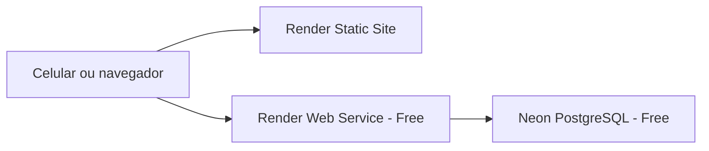

# Publicação do piloto — Render e Neon

Preparação em 14/10/2026. O repositório contém a configuração de publicação; a disponibilidade real depende de criar os recursos nas contas Render/Neon, preencher as variáveis e conferir os endereços finais. Um build local bem-sucedido não equivale a um serviço publicado.

## O que será publicado

O navegador carrega a interface estática e envia cadastro/busca para a API HTTPS. O banco é acessado somente pela API. Nenhum notebook precisa ficar ligado após a publicação. Esta publicação oferece catálogo e mapa 2D; a câmera AR continua exigindo aplicativo nativo.

## Arquivos de publicação

- [`render.yaml`](../render.yaml): API Docker com plano `free`, front estático, URLs interligadas e `/health` para verificar conexão/tabela do catálogo. Não cria banco Render, disco pago ou instância paga.
- [`scripts/render-build-web.mjs`](../scripts/render-build-web.mjs): instala o monorepo, compila `shared` e exporta o Expo Web em `unifacens-client/dist`. Exige endereço HTTPS da API e recusa credenciais do backend no ambiente do front.
- [`verify.yml`](../.github/workflows/verify.yml): CI com build, lint, tipos, testes com PostgreSQL real e exportação web. As variáveis usadas pelo CI são exemplos, sem conexão ao banco de coleta.
- `.env.api.example` e `.env.client.example`: templates locais. Os valores reais ficam nos arquivos ignorados pelo Git ou nos painéis dos provedores.

O Blueprint usa a branch selecionada ao importá-lo para ambos os serviços. Depois de um merge, confira a branch de publicação no Render para receber as próximas alterações.

## 1. Criar um banco novo no Neon

1. Crie um projeto **UniFACENS Map** no plano **Free**. Escolha uma região próxima da API em Virginia; PostgreSQL 16 corresponde à versão usada nos testes.
2. Em **Connect**, selecione a branch/database/role destinadas a este piloto.
3. Copie a conexão com pooling para `DATABASE_URL` da **API** no Render.
4. Copie a conexão direta da mesma branch/database para `DATABASE_MIGRATION_URL`. Preserve os parâmetros SSL fornecidos pelo Neon.

Uma conexão direta também pode ser usada em `DATABASE_URL`; neste caso, a URL de migração pode ser igual à primeira. O pool da aplicação é limitado a cinco conexões. URLs diferentes devem apontar para o mesmo banco/branch.

As tabelas são criadas pelas migrações oficiais ao iniciar a API. Falha de conexão/migração impede a inicialização. O catálogo começa vazio e os exemplos de âncoras AR não são inseridos em produção. Os dados já existentes no volume local não são copiados pela troca da URL; a transferência precisa de backup/restauração separados.

As credenciais do Neon não devem ser enviadas pelo chat nem adicionadas a `.example`, Git ou `EXPO_PUBLIC_`.

Referência: [conectar ao Neon](https://neon.com/docs/connect/connect-from-any-app) e [pooling](https://neon.com/docs/connect/connection-pooling).

## 2. Criar os serviços no Render

1. No Render, selecione **New → Blueprint** e conecte este repositório.
2. Escolha a branch que contém a versão validada de `render.yaml`.
3. Confirme os recursos: **unifacens-map-api**, plano **Free**; **unifacens-map**, **Static Site**.
4. Preencha as variáveis solicitadas abaixo. No primeiro cadastro de `CORS_ORIGINS`, use a origem prevista para o front e confirme a URL real no passo seguinte; domínios podem receber um sufixo se o nome estiver ocupado.
5. Aplique o Blueprint e acompanhe os dois builds. O código da equipe é gerado automaticamente somente no ambiente da API.

| Serviço | Variável | Valor |
| --- | --- | --- |
| API | `DATABASE_URL` | URL completa Neon com pooling/SSL |
| API | `DATABASE_MIGRATION_URL` | URL direta da mesma branch/database |
| API | `CORS_ORIGINS` | Origem HTTPS real do front, sem caminho; exemplo fictício: `https://SEU-FRONT.onrender.com` |
| API | `TEAM_ACCESS_TOKEN` | Gerado automaticamente pelo Render; manter apenas na API |
| Front | `EXPO_PUBLIC_API_URL` | Obtido automaticamente da URL pública da API pelo Blueprint |
| Front | `EXPO_PUBLIC_GOOGLE_MAPS_WEB_API_KEY` | Chave web restrita ao domínio final do front |
| Front | `EXPO_PUBLIC_GOOGLE_MAPS_MAP_ID` | Inicialmente `DEMO_MAP_ID`; pode ser substituído por um Map ID próprio |

`CORS_ORIGINS` aceita várias origens separadas por vírgula. Em produção, vazio bloqueia o uso da API pelo navegador; isso não é autenticação. O código da equipe protege as operações mesmo em requisições fora do navegador.

Variáveis com `sync: false` são preenchidas no painel e preservadas nas próximas sincronizações. Os arquivos `.env` locais não são enviados ao Render. Alterar variáveis públicas do front exige novo build; alterar as variáveis da API exige reiniciar/republicar o serviço.

Se preferir criar os serviços manualmente, mantenha a raiz do repositório como contexto: API **Docker**, Dockerfile `unifacens-api/dockerfile`, healthcheck `/health`; front **Static Site**, build `node scripts/render-build-web.mjs`, diretório publicado `unifacens-client/dist`, Node 24 e `SKIP_INSTALL_DEPS=true`. Configure `EXPO_PUBLIC_API_URL` manualmente com a URL HTTPS final da API. Replique as regras de rewrite de `/ar`, `/explore` e `/_sitemap` do Blueprint.

Referências: [Blueprint](https://render.com/docs/blueprint-spec), [static sites](https://render.com/docs/static-sites) e [planos gratuitos](https://render.com/docs/free).

## 3. Confirmar os endereços e o Google Maps

1. Copie a URL real do **front** no Render e atualize `CORS_ORIGINS` da **API** com essa origem exata.
2. Na chave web do Google Cloud, autorize `https://SEU-FRONT.onrender.com/*`, substituindo pelo domínio real, e restrinja à Maps JavaScript API.
3. Confira `EXPO_PUBLIC_API_URL` do front; deve ser a URL HTTPS pública da API, sem apontar para IP local ou `localhost`.
4. Se mudou variáveis do front, publique novamente. Abra `/health` da API e espere `{ "status": "ok" }`.
5. Abra o front pelo celular usando outra rede e teste o fluxo abaixo. Só compartilhar como disponível após essa verificação real.

## 4. Coleta pública e acesso da equipe

Qualquer visitante pode consultar e cadastrar um local. Novos registros e edições ficam **Ainda não verificado**; não existe aprovação física ou de acessibilidade automática.

Para editar, a equipe usa **Acesso da equipe** na tela Campus e informa o `TEAM_ACCESS_TOKEN` gerado no serviço da API. O campo é mascarado e o código é validado por `/access/team`. A credencial fica somente na memória da sessão; sair ou recarregar a página encerra o acesso.

O código não deve ser colocado no ambiente do front nem compartilhado com quem apenas contribui. Também protege exclusão e gravação de âncoras AR. Para invalidar o acesso existente, substitua-o no Render e publique novamente a API; uma tentativa de edição com o código anterior será recusada.

Esse mecanismo é um acesso compartilhado para o piloto: não identifica cada integrante, não registra autoria individual e não oferece recuperação de conta. Evoluções futuras podem substituir o código por contas/perfis. O cadastro público ainda não oferece CAPTCHA, deduplicação ou moderação com aprovação; os dados devem ser conferidos pela equipe antes de uso para deslocamento.

## 5. Verificação antes de iniciar a coleta

- Consulta e cadastro pelo celular funcionam em uma rede diferente do computador de desenvolvimento.
- Salvar um registro de **Demonstração**, recarregar a página e encontrar os mesmos dados.
- Sem código: edição não aparece; `PATCH`/`DELETE` retornam 401.
- Com código: editar, confirmar os dados e sair; edição volta a ficar indisponível.
- Mapa carrega no domínio publicado; se falhar, campos manuais continuam disponíveis.
- Excluir o registro de demonstração pela equipe e conferir que o catálogo ficou pronto para os dados reais.
- Guardar um backup do banco antes de um levantamento importante.

O Render Free dorme após inatividade e pode levar cerca de um minuto para voltar. Abra o sistema antes da coleta e, se aparecer erro de conexão, aguarde e use **Tentar novamente**. As franquias de hospedagem e Neon têm limites; o uso do Google Maps possui cotas/cobrança independentes.

## Evidências locais em 14/10/2026

- 61 testes da API passaram, incluindo PostgreSQL real, permissões de escrita, validação de configuração, CORS e proteção de credenciais em URL malformada.
- Build/tipos/lint passaram; três avisos de lint preexistentes permanecem.
- Imagem de produção compilada com Node 24 e iniciada em Docker com limite de 512 MB/0,1 CPU, porta 10000, migrações reais e sem seeds AR.
- No Chromium, cadastro público, código incorreto, acesso válido, edição autenticada, saída e recarga foram testados contra essa API. Layout em 360/768/1280 px e controles próprios com pelo menos 44 px; axe-core não encontrou violações nos quatro estados registrados.
- Auditoria de dependências da API com `npm audit --workspace=unifacens-api --omit=dev` retornou zero vulnerabilidades. Isso não equivale a auditoria integral do monorepo ou do serviço publicado.
- O Blueprint foi validado contra o schema oficial do Render. O script real de build do front passou em Linux/Node 24, incluindo instalação limpa e exportação estática; API e front não contêm os arquivos `.env` locais nas imagens de validação.

Evidências: [auditoria web](./evidencias/publicacao/auditoria-acesso-web.json), [catálogo público](./evidencias/publicacao/catalogo-publico-desktop.png), [acesso da equipe mobile](./evidencias/publicacao/acesso-equipe-360.png) e [tablet](./evidencias/publicacao/acesso-equipe-768.png).

Essas evidências não comprovam acesso às contas Render/Neon, conexão ao banco remoto ou disponibilidade do domínio público. A validação nativa/AR e a verificação dos locais reais continuam pendentes.
